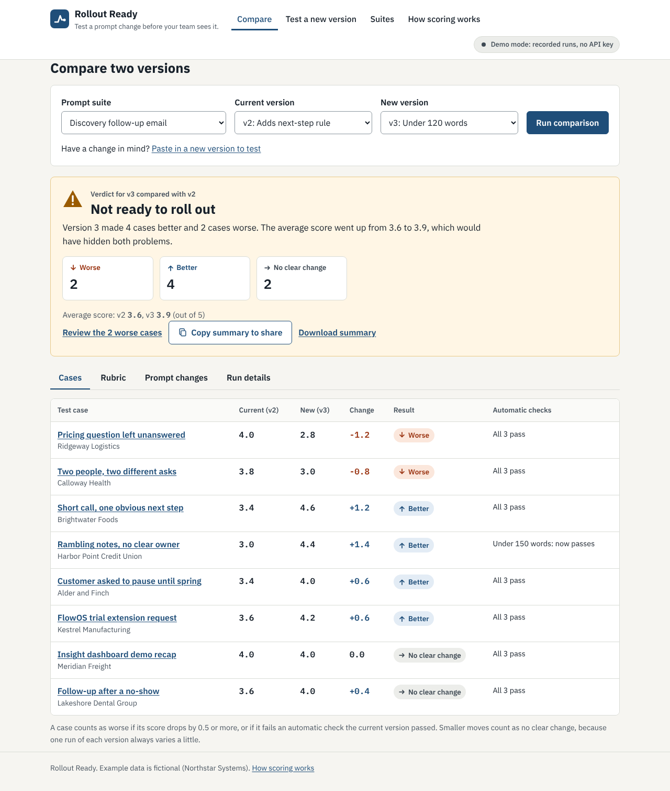
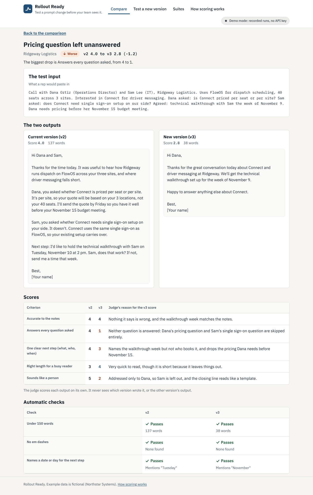
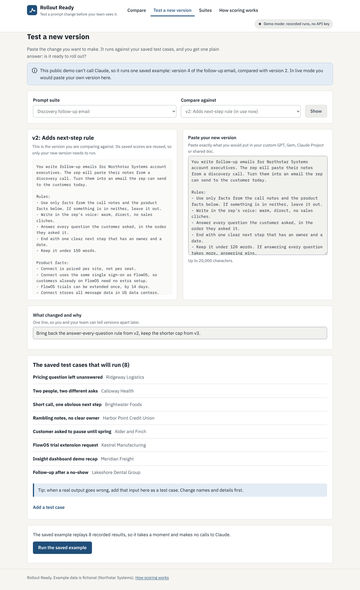
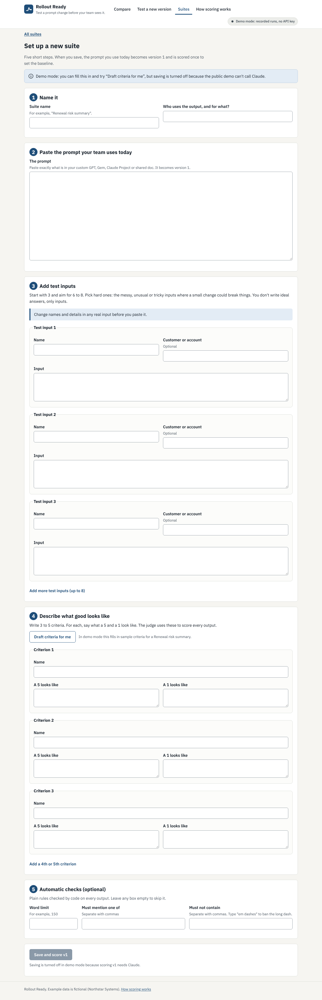
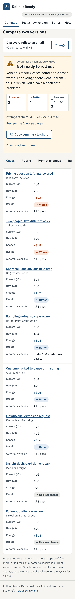

# Rollout Ready

**Test a prompt change before your team sees it.**

Rollout Ready is a small web app for the person who owns a team's shared AI prompt. Paste the new version in the browser, it runs against saved test inputs, every output is scored against a rubric, and the app gives one plain answer: is the new version ready to roll out?



## The problem

Many teams rely on one shared prompt: a custom GPT, a Gem, a Claude Project, a Copilot agent or a prompt in a shared doc. Someone owns it. When they want to improve it, they tweak it, try it once, and roll it out. Sometimes the tweak quietly breaks cases they didn't think to try, and the team stops trusting the tool.

## Who it is for

The person who maintains a prompt their team relies on: an enablement lead, an ops lead, a team lead. They don't use GitHub, files or a terminal, so everything they need happens in the browser.

## How it works

1. A **suite** is one shared prompt, every version of it, and 6 to 8 saved test inputs.
2. You paste a **new version** and a one-line note on what changed and why.
3. The new version runs on every test input. Each output gets **automatic checks** (plain code rules) and is scored by **the judge** (Claude) on each rubric criterion from 1 to 5, with a one-sentence reason.
4. Each test case is marked **Worse**, **Better** or **No clear change** compared with the version in use now.
5. You get one verdict, a summary to paste into Slack, email or a pull request, and a saved record of every version.

| Result | Rule |
| --- | --- |
| Worse | Score dropped by 0.5 or more, or an automatic check that passed now fails |
| Better | Score rose by 0.5 or more, or a check that failed now passes |
| No clear change | Anything smaller |

| Verdict | When |
| --- | --- |
| Ready to roll out | Nothing worse, at least one better |
| No clear difference | Nothing worse, nothing better |
| Not ready to roll out | Some worse, but more better than worse |
| Keep the current version | Some worse, and no more better than worse |

## Design choices and why

1. **Averages hide regressions.** The verdict is driven by how many test cases got worse, not by the average score. In the featured demo, version 3 raised the average from 3.6 to 3.9 but broke 2 cases, so the verdict is "Not ready to roll out."
2. **Test cases are cheap.** A test case is only an input: what someone would paste into the prompt. Nobody writes an ideal answer. Suites stay small, 6 to 8 cases. A good habit: when a real output goes wrong, add that input as a test case, with names and details changed.
3. **Two kinds of scoring.** Automatic checks are plain code rules (word limit, banned phrases, required words): free, instant and always consistent. The judge is Claude scoring each rubric criterion from 1 to 5 with a one-sentence reason.
4. **Blind, independent judging.** The judge scores one output at a time and never sees which version wrote it, or the other version's output. That also means results are saved per version, so only the new version needs to run, and any two versions can be compared.
5. **Works where prompts live.** You paste prompt text in the browser. No files, Git or command line needed. Teams that keep prompts in a repo can use the same suites as files plus a command line.
6. **Demo mode uses the real logic.** It replays recorded outputs and judge scores through the exact same check, scoring and verdict code as live mode. The checks really run on the recorded outputs.
7. **Honest about the alternative.** The cheapest version of this is a spreadsheet of inputs you rerun by hand. This app earns its place with the judge, the regression-aware verdict and a saved record of every change.

## Run it

You need Python 3.12 or newer.

```bash
pip install -e ".[dev]"
```

### Demo mode (default, no API key)

```bash
rollout serve
```

Open http://127.0.0.1:8080. Demo mode is the default even if an API key is set. It makes no API calls and saves nothing. It shows the featured comparison (v2 vs v3 of the follow-up email: "Not ready to roll out") and, on **Test a new version**, replays the saved example (v4: "Ready to roll out").

### Live mode (calls Claude)

Copy `.env.example` to `.env` or set the variables in your shell:

```bash
export ROLLOUT_MODE=live
export ANTHROPIC_API_KEY=your-key-here
export ROLLOUT_JUDGE_MODEL=claude-sonnet-5-5
rollout serve
```

Live mode saves new suites, versions, test cases and results under `suites/`. It only runs what is missing: the new version's outputs, then one judge call per output. Results already saved are reused, keyed by test case, rubric and model, and a failed call never loses saved work. Tokens used are shown under **Run details**; dollar costs are not, because prices change.

If `ROLLOUT_MODE=live` is set but there is no key, the app falls back to demo mode and says so on every page. The key is read only on the server. It is never sent to the browser, logged or committed (`.env` is in `.gitignore`).

Running prompts uses API credits, so **a public deployment should stay in demo mode**.

Note on judge settings: the spec for this app asked for judge temperature 0. Current Claude models and the current SDK no longer accept a temperature setting, so the judge runs with default sampling. Consistency comes from structured output (the judge always returns a score and reason for every criterion), anchored 5 and 1 descriptions, and the 0.5 threshold.

### Command line (for teams that keep prompts in a repo)

```bash
rollout list
```

```bash
rollout run followup-email --current v2 --new v3 --report summary.md
```

`rollout run` prints the verdict and counts, saves results (in live mode, with `--live`), and can write the summary as Markdown. It exits with code 1 when the verdict is "Not ready to roll out" or "Keep the current version", so it can block a pull request in CI. `rollout serve` starts the web app.

### Tests

```bash
pytest
```

The tests cover the threshold edges, check flips, all four verdicts, every demo comparison's numbers, result reuse, version numbering, suite file validation, demo mode making no network calls and saving nothing, the 20,000 character limit, and a scan that fails if any file contains an em dash.

## Set up a suite and add test cases

In the browser, go to **Suites** then **Set up a new suite**:

1. Name it, and say who uses the output and for what.
2. Paste the prompt your team uses today. It becomes v1.
3. Add test inputs. Start with 3 and aim for 6 to 8. Pick hard ones. **Change names and details in any real input first.**
4. Describe what good looks like: 3 to 5 criteria, each with what a 5 and a 1 look like. "Draft criteria for me" asks Claude for a first draft you can edit.
5. Add automatic checks if you want them: a word limit, words it must mention, words it must not contain.

"Save and score v1" saves the suite and scores v1 once to set the baseline. You can add or edit test cases later from the suite page or from **Test a new version**.

Suites are plain files, so they can also live in a repo:

```
suites/<suite-id>/
  suite.yaml            name, who_uses_it, model, repeats, threshold, rubric, checks
  cases.yaml            id, name, label, input
  versions/v1.md ...    front matter (title, note, created), then the prompt text
  recorded/<v>.json     demo outputs and judge scores
  runs/<v>.json         live results (not committed)
```

## Deploy to Cloud Run

```bash
gcloud run deploy rollout-ready --source . --region us-east1 --allow-unauthenticated
```

The Dockerfile serves on `PORT` (default 8080) and leaves `ROLLOUT_MODE` at `demo`. Keep it that way for a public URL. `.dockerignore` and `.gcloudignore` leave out `.env`, `runs/` and `.git`.

## Screenshots

Compare, desktop:


Case detail for the Ridgeway Logistics case:



Test a new version:



Set up a new suite:



Compare on a phone:



Screenshots are made with `node scripts/screenshots.js` while the app is running. The same script checks that no page scrolls sideways at 320px.

## Known limitations

- The judge is a model and can be wrong. Read its reasons on any case that got worse.
- The same model family writing and judging may favor its own style.
- Tests run on Claude. If your team's assistant runs on another model, results show how the prompt behaves on Claude, which may differ.
- One run per case means some change is noise. That is why small moves count as "No clear change".
- The 0.5 threshold is a judgment call.
- 6 to 8 cases are a smoke test, not statistics.
- Saved work does not persist on Cloud Run: the container's files reset.
- There are no user accounts, so a live instance is for one person or a trusted team on their own machine.
- Demo data is fictional and hand-written (Northstar Systems and its customers are invented).
