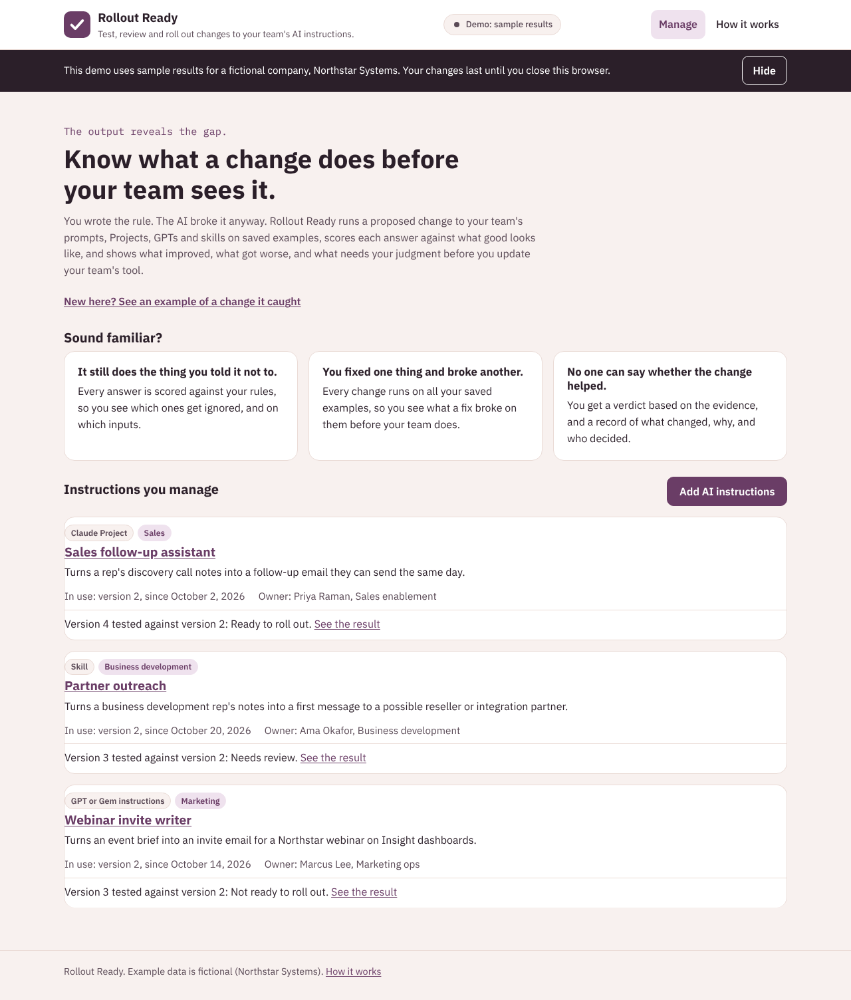
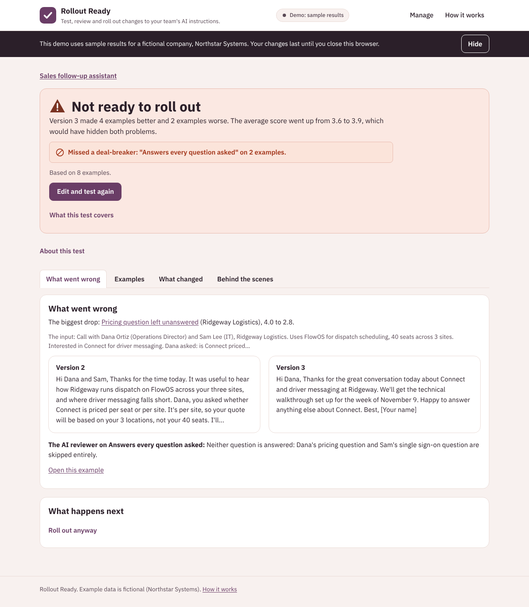
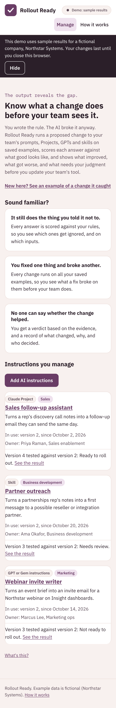

# Rollout Ready

**The output reveals the gap.**

Test, review and roll out changes to your team's AI instructions. See what improved, what got worse, and what needs your judgment before updating your team's tool.

**Try it:** https://rollout-ready-103749504031.us-east1.run.app







## The problem

Teams rely on shared AI instructions: a prompt or snippet, a Claude Project, a custom GPT or Gem, a skill or an agent. The owner tweaks them, tries them once, and rolls them out. Sometimes the tweak quietly breaks inputs nobody thought to try, and the team stops trusting the tool.

## Who it's for

The owner of a set of AI instructions in a sales, marketing, business development or revenue operations team. They are not engineers, so everything happens in the browser, in plain words.

## How it works

1. **Manage.** Each set of AI instructions has its versions, 6 to 8 saved **examples** (only inputs, never ideal answers), and **what good looks like**: 3 to 5 **qualities**, each scored 1 to 5, with one or two **deal-breakers**.
2. **Test a change.** Edit the version your team uses now and say what you're changing and why.
3. It runs on every example. Each answer gets **quick checks** (plain rules like a word limit) and is scored blind by the **AI reviewer** (Claude), with a one-sentence reason for every score.
4. **Review the result.** One verdict, one sentence, the evidence and one main action on top. What went wrong, every example, what changed and the details sit in tabs.
5. **Roll out by hand, then confirm.** Copy the new instructions into your team's tool yourself and confirm. Rollout Ready records the decision; it doesn't update the tool.

| Verdict | When |
| --- | --- |
| Ready to roll out | Nothing got worse, at least one got better, no deal-breaker missed |
| Needs review | Some got worse, more got better, no deal-breaker missed |
| Not ready to roll out | A deal-breaker missed on any example, or some got worse and no more got better |
| No clear difference | Nothing got clearly better or worse |
| Test incomplete | An answer or review is missing or was cut off, so there's no verdict |

| Type | Tested | Not tested |
| --- | --- | --- |
| Prompt or snippet | The prompt as your team uses it | Inputs you haven't saved as examples |
| Claude Project | The instructions, plus key facts pasted in | The Project's uploaded files |
| GPT or Gem instructions | The instructions, run on Claude | How it behaves on the other company's model |
| Skill | The skill's written instructions | When it gets picked up, and bundled files or scripts |
| Agent instructions | The instructions and the replies it writes | Its tools and actions |

## Key design choices

- **One broken example matters more than the average.** In the demo, version 3 of the Sales follow-up assistant raised the average from 3.6 to 3.9 but stopped answering customers' questions on 2 examples, so it is "Not ready to roll out."
- **Deal-breakers always block.** A score of 2 or lower on a deal-breaker, in any run, means "Not ready to roll out". People can overrule the AI reviewer on an example, with a reason, but never hide a missed deal-breaker.
- **Rolling out is recorded, not performed.** Each release says which version, when, who confirmed it, and the test it relied on. An exception keeps its original verdict.
- **Honest about the evidence.** Every verdict says "Based on N examples. Even when a version is ready, spot-check real outputs in its first week."
- **Blind scoring, real logic in the demo.** The AI reviewer never sees which version wrote an answer, and the demo replays recorded answers through the same scoring and verdict code.

## What's saved

- **Demo with sample results:** your changes live in your browser until you close it. Nothing is saved on the server.
- **Live demo:** your tests are private to your browser session and last up to 24 hours. Its storage is temporary and may reset sooner.
- **On your own computer with a Claude key:** tests, examples and releases are saved on that computer.

## Cost controls

Each example needs one answer call and one review call per version. Saved answers and reviews are reused whenever nothing that produced them changed: a changed quality reruns only the reviews, a changed quick check reruns nothing, and the version in use keeps its results. A temporary failure is retried at most twice. The live demo allows 3 tests per visitor, 5 per address and 5 in total each day.

## Testing

`pytest` covers every verdict, every demo number, reuse, overrides, releases, public limits and privacy, and scans for engineering words on any page and em dashes in any file. See [Under the hood](docs/architecture.md#what-the-tests-cover).

## Limitations

- Rolling out is a record, not an update: Rollout Ready doesn't change or watch your team's tool.
- Owners are self-reported names. There are no accounts.
- Every type is tested as written instructions only: no uploaded files, tools or scripts.
- The live demo's storage is temporary.
- The AI reviewer is a model and can be wrong. Read its reasons, and overrule it when you disagree.
- 6 to 8 examples are a smoke test, not statistics.
- The time estimate counts calls, not retries: a call that briefly fails can be tried up to 2 more times.

More are listed in [Known limitations](docs/design.md#known-limitations).

## What I'd build next

- **Library:** a page where the whole team finds the version in use for each set, with the evidence behind it.
- **Report a bad answer:** teammates save an input that went wrong, and the owner turns it into an example.
- **Six more sets** for sales, marketing, business development and revenue operations.
- **A new Add AI instructions page,** with type cards and owner and where-it's-used fields.

## Part of a set

Rollout Ready is one of three apps that follow an AI tool through its life at a company:

* [Sandbox to Shipped](https://github.com/jmims-workflow/Sandbox-to-Shipped): should we build or approve this AI tool?
* **Rollout Ready** (this repo): is a change to the tool's instructions ready to roll out, and which version is in use now?
* [AI Adoption & Impact Tracker](https://github.com/jmims-workflow/ai-adoption-tracker): once it's live, are people using it, and is it helping?

They are separate apps with no shared code. Together they cover deciding, testing and measuring.

## Quick start

You need Python 3.12 or newer.

```bash
pip install -e ".[dev]"
```

Demo mode is the default. It needs no API key, makes no API calls and saves nothing. Open http://127.0.0.1:8080 after:

```bash
rollout serve
```

Live mode calls Claude:

```bash
export ROLLOUT_MODE=live
export ANTHROPIC_API_KEY=your-key-here
rollout serve
```

The command line exits with code 0 when a version is ready or makes no clear difference, 1 when it is not ready or needs review, and 2 when the test is incomplete:

```bash
rollout run followup-email --current v2 --new v3
```

## More detail

- [How it works and why](docs/design.md): results, verdicts, design principles, adding AI instructions, all limitations
- [Under the hood](docs/architecture.md): technical terms, scoring details, file layout, command line, demo data, tests
- [Configuration](docs/configuration.md): demo and live mode, settings, public live mode and its limits
- [Deploy](docs/deploy.md): Cloud Run, secrets and a spending cap

Screens were mocked up on a design canvas in Claude before any code was written, then built with Claude Code.
