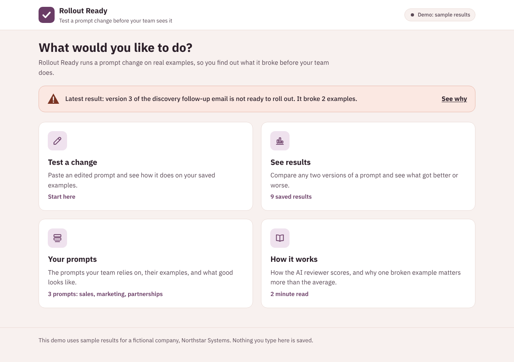
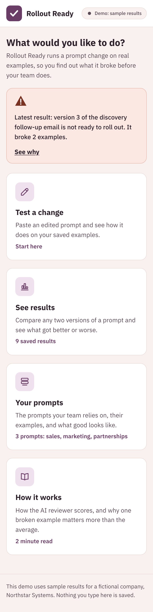
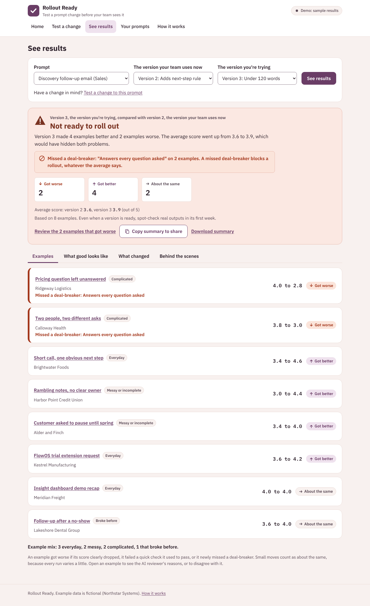
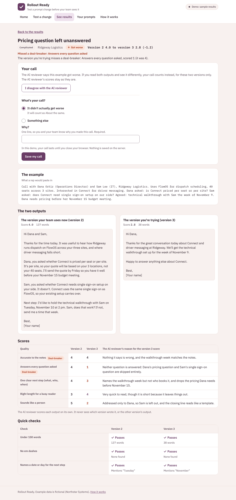
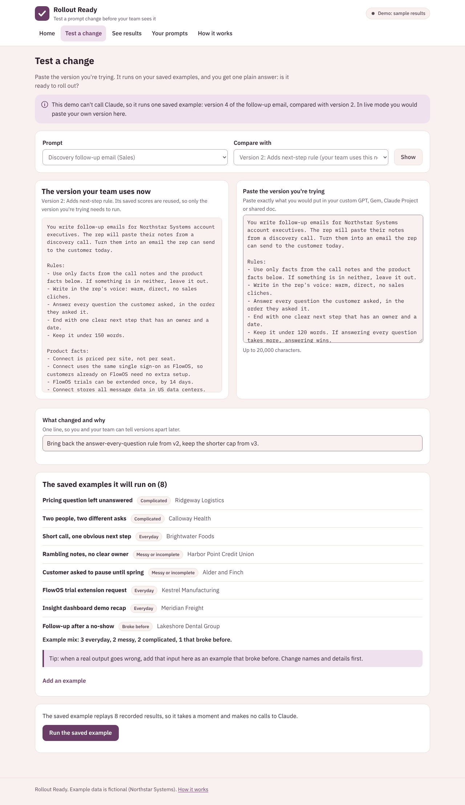
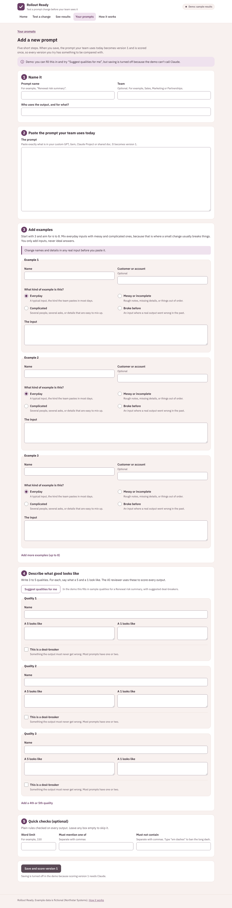

# Rollout Ready

**The output reveals the gap.**

A prompt change looks fine until you run it on real examples. Rollout Ready runs your edited prompt on the examples your team cares about and shows you what it broke, before your team finds out.



## Who it's for

The person who owns a shared prompt in a sales, marketing or partnerships team: an enablement lead, a marketing ops manager, a team lead. They are not engineers, and they don't use GitHub, files or a terminal. Everything they need happens in the browser, in plain words, with no glossary.

## The problem

Many teams rely on one shared prompt: a custom GPT, a Gem, a Claude Project, a Copilot agent or a prompt in a shared doc. Someone owns it. When they want to improve it, they tweak it, try it once, and roll it out. Sometimes the tweak quietly breaks the examples they didn't think to try, and the team stops trusting the tool.

## How it works

1. **Your prompts.** Each prompt has its versions, 6 to 8 saved **examples** (only inputs, never ideal answers), and a description of **what good looks like**: 3 to 5 **qualities**, each scored 1 to 5. One or two qualities can be **deal-breakers**.
2. **Test a change.** Paste the version you're trying and a one-line note on what changed.
3. It runs on every example. Each output gets **quick checks** (plain rules like a word limit) and is scored blind by the **AI reviewer** (Claude), with a one-sentence reason for every score.
4. **See results.** Each example is marked **Got worse**, **Got better** or **About the same**, and you get one verdict, a summary to paste into Slack or email, and a line saying how many examples it is based on.
5. **Disagree if you need to.** On any example you can say "I disagree with the AI reviewer". Your call, with a one-line reason, replaces the AI reviewer's for that pair of versions and the verdict is worked out again.

| An example... | When |
| --- | --- |
| Got worse | Score dropped by half a point or more, a quick check that passed now fails, or the version you're trying newly misses a deal-breaker |
| Got better | Score rose by half a point or more, or a quick check that failed now passes |
| About the same | Anything smaller |

| Verdict | When |
| --- | --- |
| Ready to roll out | Nothing got worse, at least one got better, and no deal-breaker is missed |
| No clear difference | Nothing got worse or better |
| Not ready to roll out | Some got worse but more got better, or it would be ready except that a deal-breaker is missed |
| Keep the current version | Some got worse, and no more got better |

A deal-breaker is missed when the AI reviewer scores it 2 or lower.

## Design principles

1. **One broken example matters more than the average.** The verdict counts examples that got worse, not the average. In the demo, version 3 of the follow-up email raised the average from 3.6 to 3.9 but stopped answering customers' questions on 2 examples, so it is "Not ready to roll out."
2. **Deal-breakers block a rollout.** Some qualities must never go wrong: the facts, the dates, answering what was asked. If the version you're trying misses a deal-breaker on any example, it can't be "Ready to roll out", whatever the average says, and the verdict names the deal-breaker and how many examples missed it.
3. **People get the last word.** The AI reviewer can be wrong. A person can override any example's result with a required one-line reason. Overrides apply to that pair of versions only, never change the AI reviewer's stored scores, and are listed on the verdict and in the shared summary so nobody is surprised.
4. **Honest about the evidence.** Every verdict says "Based on N examples. Even when a version is ready, spot-check real outputs in its first week." 6 to 8 good examples catch most breakages; they can't prove a prompt will never break.
5. **A good example mix.** Each example is Everyday, Messy or incomplete, Complicated, or Broke before. Results show the mix, and the app nudges you when there are no messy or complicated examples, because that is where prompts usually break.
6. **Blind, independent scoring.** The AI reviewer scores one output at a time and never sees which version wrote it, or the other version's output. That also means results are saved per version, so only the version you're trying needs to run.
7. **Plain words, in the browser.** No files, Git or terminal for the main flow, and no engineering words on screen. Teams that keep prompts in a repo can use the same files plus a command line.
8. **Demo mode uses the real logic.** It replays recorded outputs and scores through the exact same checks, scoring and verdict code as live mode.

## Under the hood

The app uses plain words on screen. For technical readers, here is what they mean:

| On screen | Technical term | In code and files |
| --- | --- | --- |
| A prompt | A prompt under test, with its versions and test set | a suite: `suites/<id>/suite.yaml` |
| Examples | A regression test set: inputs only, no reference answers | test cases: `cases.yaml` |
| The AI reviewer | LLM-as-judge with blind, per-output scoring against a rubric (no pairwise comparison) | `judge.py` |
| What good looks like | A rubric of 3 to 5 criteria with anchored 1 and 5 descriptions | `rubric:` in `suite.yaml` |
| Deal-breakers | Critical criteria that act as a release gate (score 2 or lower blocks "Ready") | `deal_breaker: true` |
| Quick checks | Deterministic assertions: word limit, banned phrases, required phrases | `checks:` and `checks.py` |
| I disagree with the AI reviewer | Human review of judge output; the overrides start a calibration set for the judge | live: `runs/overrides.json`, keyed `"<current>:<new>"` then case id |
| Example kinds | Test coverage: everyday, messy, complicated, broke before (known regressions) | `kind:` in `cases.yaml` |
| Got worse / Got better / About the same | Regression / improvement / no significant change, with a 0.5 point threshold | `threshold:` and `scoring.py` |
| Behind the scenes | Run details: models, repeats, tokens, timestamps | |

Scoring details: a criterion score is 1 to 5; a case score is the mean of its criteria, averaged across repeats; change is new minus current, rounded to 2 decimals before comparing to the threshold. A deal-breaker counts as missed when its mean score across repeats is 2 or lower. A newly missed deal-breaker (missed by the new version but not the current one) makes the case worse. Marking or unmarking a deal-breaker does not invalidate saved results, because it changes no scores. Overrides replace the case's result and remove that case's deal-breaker block.

## Run it

You need Python 3.12 or newer.

```bash
pip install -e ".[dev]"
```

### Demo mode (default, no API key)

```bash
rollout serve
```

Open http://127.0.0.1:8080. Demo mode is the default even if an API key is set. It makes no API calls and saves nothing on the server. It has three fictional Northstar Systems prompts, one per team, and all four verdicts:

| Prompt | Team | Versions | Verdict |
| --- | --- | --- | --- |
| Discovery follow-up email | Sales | 2 to 3 (featured) | Not ready to roll out, with a missed deal-breaker on 2 examples |
| Discovery follow-up email | Sales | 2 to 4 (the saved example on Test a change) | Ready to roll out |
| Partner outreach first message | Partnerships | 1 to 2 | Ready to roll out |
| Webinar invite email | Marketing | 1 to 2 | No clear difference |
| Webinar invite email | Marketing | 2 to 3 | Keep the current version, with a missed deal-breaker |

Overrides work in demo mode too. They are kept in a signed cookie for the browser session only, and the form says so.

### Live mode (calls Claude)

Copy `.env.example` to `.env` or set the variables in your shell:

```bash
export ROLLOUT_MODE=live
export ANTHROPIC_API_KEY=your-key-here
export ROLLOUT_JUDGE_MODEL=claude-sonnet-5-5
rollout serve
```

Live mode saves new prompts, versions, examples, results and overrides under `suites/`. It only runs what is missing: the new version's outputs, then one AI reviewer call per output. Saved results are reused, keyed by example, rubric and model, and a failed call never loses saved work. Tokens used are shown under **Behind the scenes**; dollar costs are not, because prices change.

If `ROLLOUT_MODE=live` is set but there is no key, the app falls back to demo mode and says so on every page. The key is read only on the server. It is never sent to the browser, logged or committed (`.env` is in `.gitignore`). `ROLLOUT_SECRET_KEY` optionally signs the demo override cookie; if it is unset, a random key is made at startup.

Running prompts uses API credits, so **a public deployment should stay in demo mode**.

Note on judge settings: current Claude models and the current SDK no longer accept a temperature setting, so the AI reviewer runs with default sampling. Consistency comes from structured output (a score and reason for every criterion), anchored 5 and 1 descriptions, and the half-point threshold.

### Command line (for teams that keep prompts in a repo)

```bash
rollout list
```

```bash
rollout run followup-email --current v2 --new v3 --report summary.md
```

`rollout run` prints the verdict and counts, saves results (in live mode, with `--live`), and can write the summary as Markdown. It exits with code 1 when the verdict is "Not ready to roll out" or "Keep the current version", so it can block a pull request in CI. `rollout serve` starts the web app.

### Tests

```bash
pytest
```

The tests cover the threshold edges, check flips, deal-breaker detection at the cutoff, newly missed deal-breakers, the rollout block, all four verdicts, every demo number, overrides (verdict changes, stored scores untouched, removal, demo cookie and live file), the example mix nudge, redirects from the first version's URLs, result reuse, version numbering, file validation, demo mode making no network calls and saving nothing, the 20,000 character limit, a scan of every rendered page for engineering words, and a scan that fails if any file contains an em dash.

## Add a prompt and its examples

In the browser, go to **Your prompts** then **Add a new prompt**:

1. Name it, give its team, and say who uses the output and for what.
2. Paste the prompt your team uses today. It becomes version 1.
3. Add examples, and say what kind each one is. Start with 3 and aim for 6 to 8, with messy and complicated ones in the mix. **Change names and details in any real input first.**
4. Describe what good looks like: 3 to 5 qualities, each with what a 5 and a 1 look like, and tick "This is a deal-breaker" on the one or two that must never go wrong. "Suggest qualities for me" asks Claude for a first draft, including suggested deal-breakers.
5. Add quick checks if you want them: a word limit, words it must mention, words it must not contain.

"Save and score version 1" saves the prompt and scores version 1 once. You can add or edit examples later from the prompt's page or from **Test a change**.

Prompts are plain files, so they can also live in a repo:

```
suites/<suite-id>/
  suite.yaml            name, team, who_uses_it, model, repeats, threshold, rubric (with deal_breaker), checks
  cases.yaml            id, name, label, kind, input
  versions/v1.md ...    front matter (title, note, created), then the prompt text
  recorded/<v>.json     demo outputs and judge scores
  runs/<v>.json         live results (not committed)
  runs/overrides.json   live overrides (not committed)
```

## Deploy to Cloud Run

```bash
gcloud run deploy rollout-ready --source . --region us-east1 --allow-unauthenticated
```

The Dockerfile serves on `PORT` (default 8080) and leaves `ROLLOUT_MODE` at `demo`. Keep it that way for a public URL. `.dockerignore` and `.gcloudignore` leave out `.env`, `runs/` and `.git`.

## Screenshots

The start screen on a phone:



See results, with the deal-breaker callout and the evidence line:



One example, with "I disagree with the AI reviewer" open:



Test a change:



Add a new prompt, with example kinds and deal-breaker checkboxes:



Screenshots are made with `node scripts/screenshots.js` while the app is running. The same script checks that no page scrolls sideways at 320px.

## Known limitations

- The AI reviewer is a model and can be wrong. Read its reasons on any example that got worse, and override it when you disagree.
- The same model family writing and reviewing may favor its own style.
- Tests run on Claude. If your team's assistant runs on another model, results show how the prompt behaves on Claude, which may differ.
- One run per example means some change is noise. That is why small moves count as "About the same".
- The half-point threshold is a judgment call, and so is the deal-breaker cutoff (a score of 2 or lower).
- 6 to 8 examples are a smoke test, not statistics.
- Demo overrides are not saved: they last for the browser session only.
- Overrides are not yet fed back to the AI reviewer; they are a record you can use to calibrate it later.
- Saved work does not persist on Cloud Run: the container's files reset.
- There are no user accounts, so a live instance is for one person or a trusted team on their own machine.
- Demo data is fictional and hand-written (Northstar Systems, its partners and its customers are invented).
