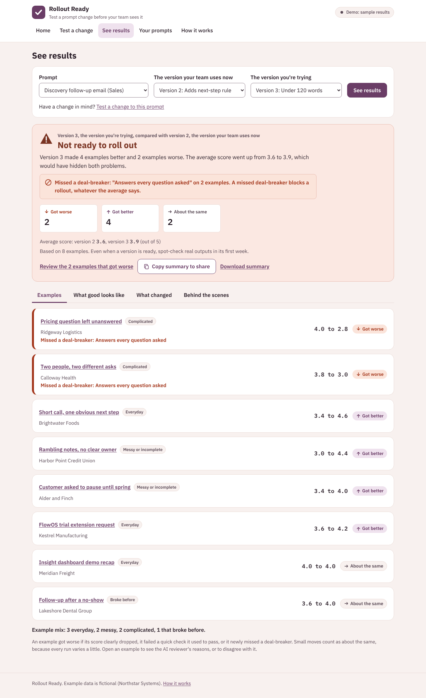
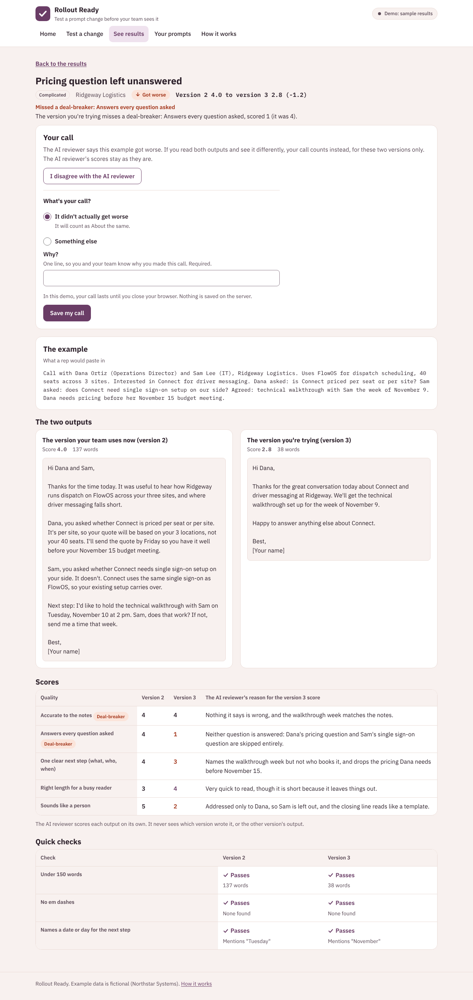

# Rollout Ready

**The output reveals the gap.**

A prompt change looks fine until you run it on real examples. Rollout Ready runs your edited prompt on the examples your team cares about and shows you what it broke, before your team finds out. It is built for the people who own a shared prompt in sales, marketing and partnerships teams, who are not engineers, so everything happens in the browser in plain words.







## The problem

Many teams rely on one shared prompt: a custom GPT, a Gem, a Claude Project, a Copilot agent or a prompt in a shared doc. Someone owns it. When they want to improve it, they tweak it, try it once, and roll it out. Sometimes the tweak quietly breaks the examples they didn't think to try, and the team stops trusting the tool.

## What it does

1. **Your prompts.** Each prompt has its versions, 6 to 8 saved **examples** (only inputs, never ideal answers), and a description of **what good looks like**: 3 to 5 **qualities**, each scored 1 to 5, with one or two **deal-breakers**.
2. **Test a change.** Paste the version you're trying and a one-line note on what changed.
3. It runs on every example. Each output gets **quick checks** (plain rules like a word limit) and is scored blind by the **AI reviewer** (Claude), with a one-sentence reason for every score.
4. **See results.** Each example is marked **Got worse**, **Got better** or **About the same**, and you get one verdict: Ready to roll out, No clear difference, Not ready to roll out, or Keep the current version. You also get a summary to paste into Slack or email.
5. **Disagree if you need to.** On any example you can say "I disagree with the AI reviewer". Your call, with a one-line reason, replaces the AI reviewer's for that pair of versions.

The full rules for each result and verdict are in [How it works and why](docs/design.md).

## Key design choices

- **One broken example matters more than the average.** In the demo, version 3 of the follow-up email raised the average from 3.6 to 3.9 but stopped answering customers' questions on 2 examples, so it is "Not ready to roll out."
- **Deal-breakers block a rollout.** If the version you're trying misses a deal-breaker (a score of 2 or lower) on any example, it can't be "Ready to roll out", whatever the average says.
- **People get the last word.** Overrides need a one-line reason, apply to one pair of versions, never change stored scores, and are listed on the verdict and in the shared summary.
- **Honest about the evidence.** Every verdict says "Based on N examples. Even when a version is ready, spot-check real outputs in its first week."
- **A good example mix.** Each example is Everyday, Messy or incomplete, Complicated, or Broke before, and the app nudges you when there are no messy or complicated ones.
- **Blind, independent scoring.** The AI reviewer scores one output at a time and never sees which version wrote it, or the other version's output.
- **Plain words, in the browser.** No files, Git or terminal for the main flow, and no engineering words on screen.
- **Demo mode uses the real logic.** It replays recorded outputs and scores through the exact same checks, scoring and verdict code as live mode.

## Testing

`pytest` covers the scoring edges, all four verdicts, every demo number, overrides, public live mode limits, and scans that fail on engineering words in any page or an em dash in any file. The full list is in [Under the hood](docs/architecture.md#what-the-tests-cover).

## Limitations

- The AI reviewer is a model and can be wrong. Read its reasons on any example that got worse, and override it when you disagree.
- The same model family writing and reviewing may favor its own style.
- Tests run on Claude. If your team's assistant runs on another model, results show how the prompt behaves on Claude, which may differ.
- 6 to 8 examples are a smoke test, not statistics.
- There are no user accounts, and saved work does not persist on Cloud Run.

More are listed in [Known limitations](docs/design.md#known-limitations).

## Part of a set

Rollout Ready is one of three apps that follow an AI tool through its life at a company:

* [Sandbox to Shipped](https://github.com/jmims-workflow/Sandbox-to-Shipped): should we build or approve this AI tool?
* Rollout Ready (this repo): does a change to the tool's prompt make it better or worse before the team sees it?
* [AI Adoption & Impact Tracker](https://github.com/jmims-workflow/ai-adoption-tracker): once it's live, are people using it, and is it helping?

They are separate apps with no shared code. Together they cover deciding, testing and measuring.

## Quick start

You need Python 3.12 or newer.

```bash
pip install -e ".[dev]"
```

Demo mode is the default. It needs no API key, makes no API calls and saves nothing. Open http://127.0.0.1:8080 after:

```bash
rollout serve
```

Live mode calls Claude:

```bash
export ROLLOUT_MODE=live
export ANTHROPIC_API_KEY=your-key-here
rollout serve
```

For teams that keep prompts in a repo, the command line exits with code 1 when a version is not ready:

```bash
rollout run followup-email --current v2 --new v3
```

## More detail

- [How it works and why](docs/design.md): results, verdicts, design principles, adding a prompt, all limitations
- [Under the hood](docs/architecture.md): technical terms, scoring details, file layout, command line, demo data, tests
- [Configuration](docs/configuration.md): demo and live mode, settings, public live mode and its limits
- [Deploy](docs/deploy.md): Cloud Run, secrets and a spending cap
