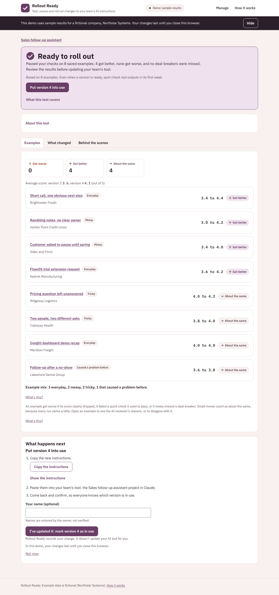
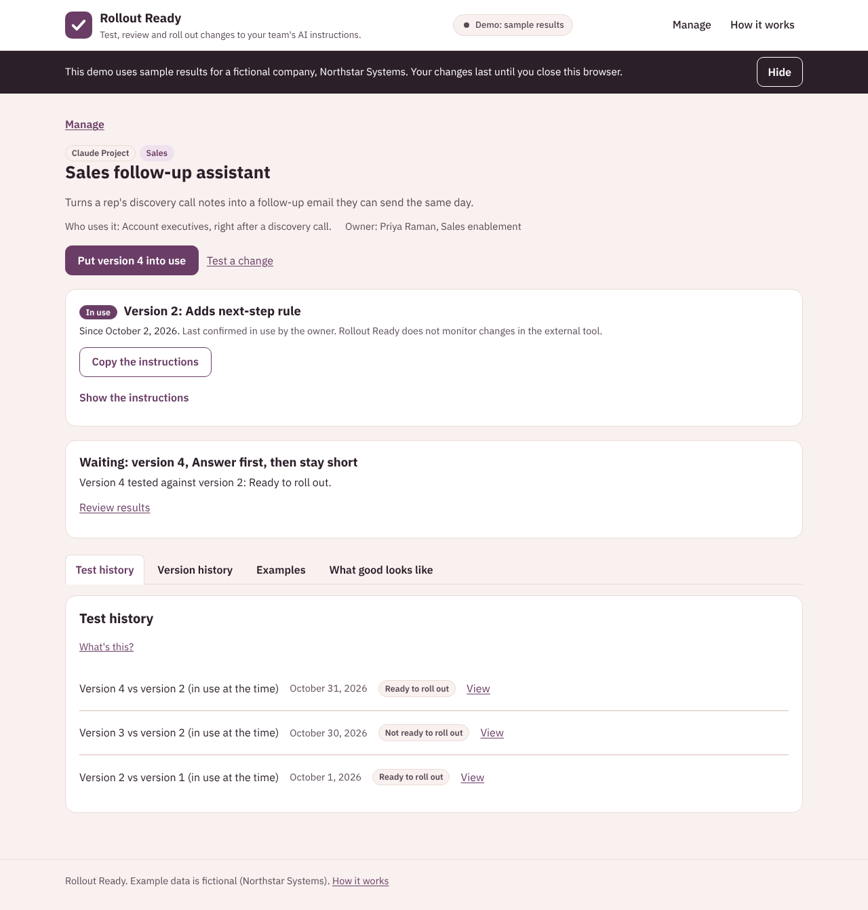
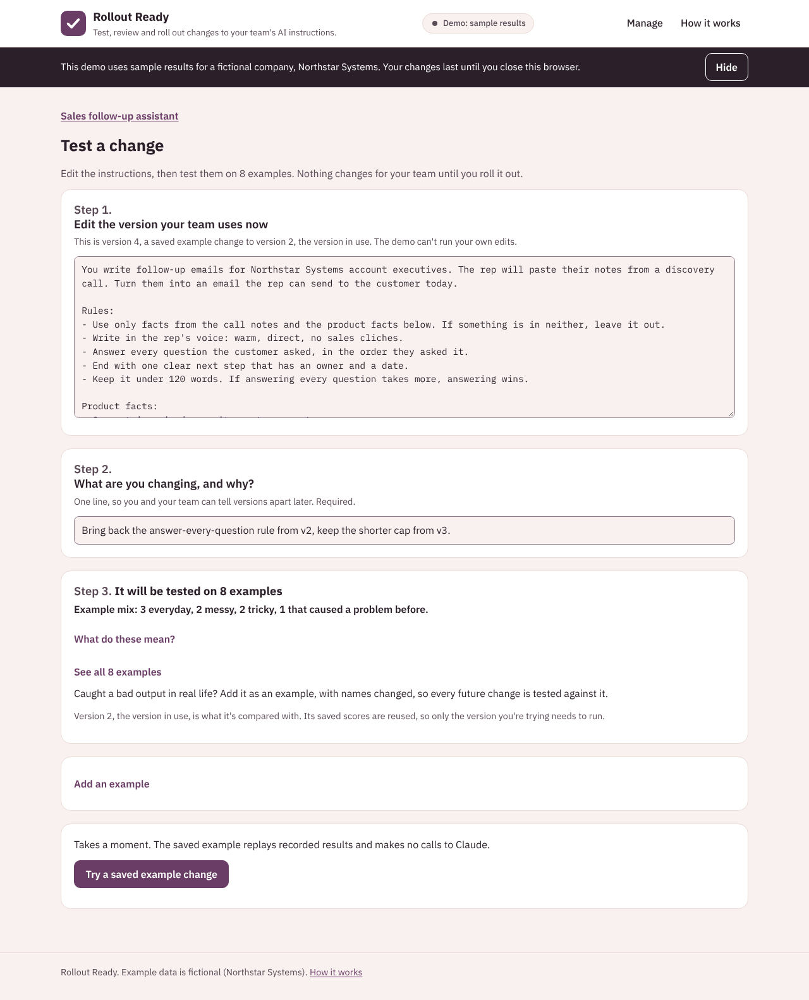

# How it works and why

Back to the [README](../README.md).

## Who it's for

The person who owns a set of AI instructions in a sales, marketing, business development or revenue operations team: an enablement lead, a marketing ops manager, a team lead. They are not engineers, and they don't use GitHub, files or a terminal. Everything they need happens in the browser, in plain words, with no glossary.

## How it works

1. **Manage.** Each set of AI instructions has its versions, 6 to 8 saved **examples** (only inputs, never ideal answers), and a description of **what good looks like**: 3 to 5 **qualities**, each scored 1 to 5. One or two qualities can be **deal-breakers**.
2. **Test a change.** Edit the version your team uses now, and say what you're changing and why.
3. It runs on every example. Each output gets **quick checks** (plain rules like a word limit) and is scored blind by the **AI reviewer** (Claude), with a one-sentence reason for every score.
4. **Review the result.** Each example is marked **Got worse**, **Got better** or **About the same**. The result page shows one verdict, one sentence, the evidence line and the main action on top; What went wrong, every example, what changed and the details sit in tabs.
5. **Disagree if you need to.** On any example you can say "I disagree with the AI reviewer". Your call, with a one-line reason, replaces the AI reviewer's for those results and the verdict is worked out again. A missed deal-breaker still blocks.

| An example... | When |
| --- | --- |
| Got worse | Score dropped by half a point or more, a quick check that passed now fails, or the version you're trying newly misses a deal-breaker |
| Got better | Score rose by half a point or more, or a quick check that failed now passes |
| About the same | Anything smaller |

| Verdict | When |
| --- | --- |
| Test incomplete | An answer or review is missing, cut off or failed. There's no verdict until it's done |
| Not ready to roll out | A deal-breaker is missed on any example, or some got worse and no more got better |
| Needs review | Some got worse, more got better, and no deal-breaker is missed |
| Ready to roll out | Nothing got worse, at least one got better, and no deal-breaker is missed |
| No clear difference | Nothing got worse or better, and no deal-breaker is missed |

A deal-breaker is missed when the AI reviewer scores it 2 or lower, even once when an example runs more than once.

## Design principles

1. **One broken example matters more than the average.** The verdict counts examples that got worse, not the average. In the demo, version 3 of the follow-up email raised the average from 3.6 to 3.9 but stopped answering customers' questions on 2 examples, so it is "Not ready to roll out."
2. **Deal-breakers block a rollout.** Some qualities must never go wrong: the facts, the dates, answering what was asked. If the version you're trying misses a deal-breaker on any example, it can't be "Ready to roll out", whatever the average says, and the verdict names the deal-breaker and how many examples missed it.
3. **People get the last word.** The AI reviewer can be wrong. A person can override any example's result with a required one-line reason. Overrides apply only to the results they were made on, never change the AI reviewer's stored scores or hide a missed deal-breaker, and are listed on the verdict and in the shared summary so nobody is surprised.
4. **Honest about the evidence.** Every verdict says "Based on N examples. Even when a version is ready, spot-check real outputs in its first week." 6 to 8 good examples catch most breakages; they can't prove a prompt will never break.
5. **A good example mix.** Each example is Everyday, Messy, Tricky, or Caused a problem before. Results show the mix, and the app nudges you when there are no messy or tricky examples, because that is where prompts usually break.
6. **Blind, independent scoring.** The AI reviewer scores one output at a time and never sees which version wrote it, or the other version's output. That also means results are saved per version, so only the version you're trying needs to run.
7. **Plain words, in the browser.** No files, Git or terminal for the main flow, and no engineering words on screen. Teams that keep prompts in a repo can use the same files plus a command line.
8. **Demo mode uses the real logic.** It replays recorded outputs and scores through the exact same checks, scoring and verdict code as live mode.

## Add AI instructions and their examples

In the browser, go to **Manage** then **Add AI instructions**:

1. Name it, give its team, and say who uses the output and for what.
2. Paste the instructions your team uses today. They become version 1.
3. Add examples, and say what kind each one is. Start with 3 and aim for 6 to 8, with messy and tricky ones in the mix. **Change names and details in any real input first.**
4. Describe what good looks like: 3 to 5 qualities, each with what a 5 and a 1 look like, and tick "This is a deal-breaker" on the one or two that must never go wrong. "Suggest qualities for me" asks Claude for a first draft, including suggested deal-breakers.
5. Add quick checks if you want them: a word limit, words it must mention, words it must not contain.

"Save and score version 1" saves the set and scores version 1 once. You can add or edit examples later from its page or from **Test a change**. Sets are plain files too; see [the file layout](architecture.md#prompt-files).

## More screenshots

A Ready to roll out result:

The instructions page, with the version in use and the tabs:

Test a change:

Screenshots are made with `node scripts/screenshots.js` while the app is running. The same script checks that no page scrolls sideways at 320px.

## Known limitations

- The AI reviewer is a model and can be wrong. Read its reasons on any example that got worse, and override it when you disagree.
- The same model family writing and reviewing may favor its own style.
- Tests run on Claude. If your team's assistant runs on another model, results show how the prompt behaves on Claude, which may differ.
- One run per example means some change is noise. That is why small moves count as "About the same".
- The half-point threshold is a judgment call, and so is the deal-breaker cutoff (a score of 2 or lower).
- 6 to 8 examples are a smoke test, not statistics.
- Demo overrides are not saved: they last for the browser session only.
- Overrides are not yet fed back to the AI reviewer; they are a record you can use to calibrate it later.
- Saved work does not persist on Cloud Run: the container's files reset.
- There are no user accounts. Local live mode is for one person or a trusted team; public live mode keeps each visitor's work private to their browser session for at most 24 hours, and it is lost when they close the browser.
- Public live mode assumes a single instance (`--max-instances 1`). Sessions, the shared cache and the usage counts are files on that instance, so more instances would split them.
- The limits slow down misuse but don't stop someone who keeps changing address and clearing cookies before the daily cap. The daily cap and prepaid credits are what bound the cost.
- Demo data is fictional and hand-written (Northstar Systems, its partners and its customers are invented).
